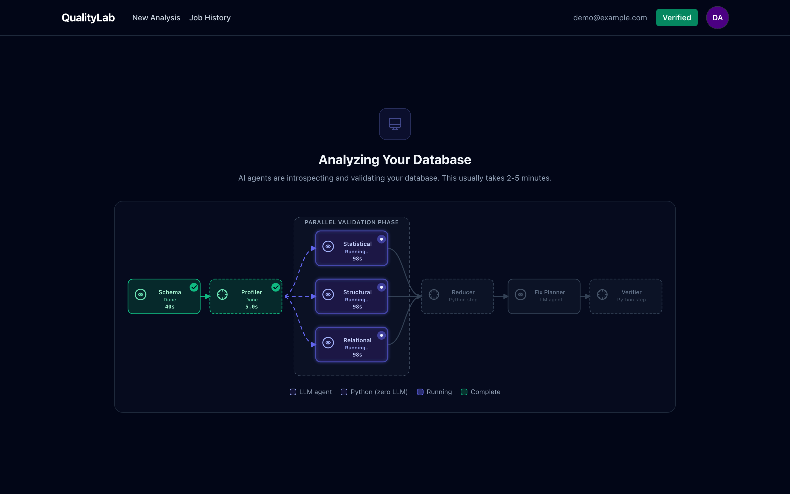
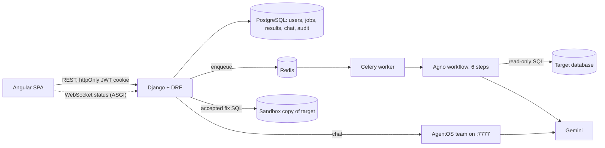
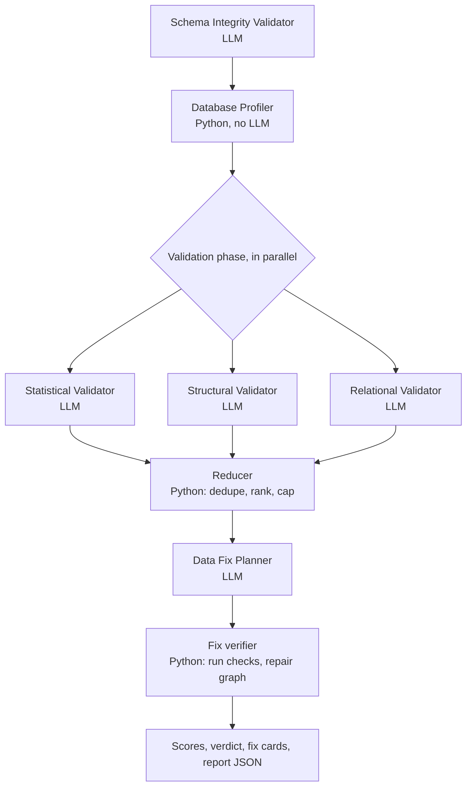
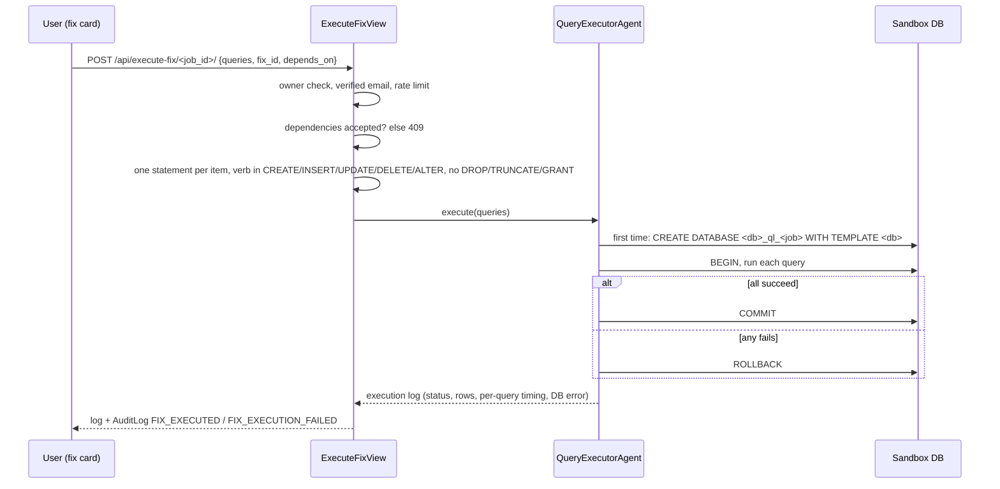
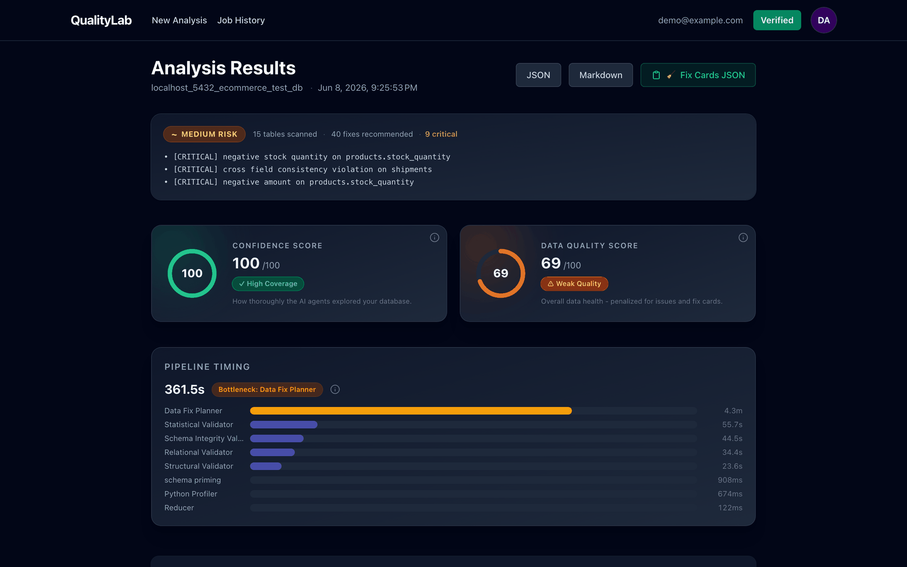
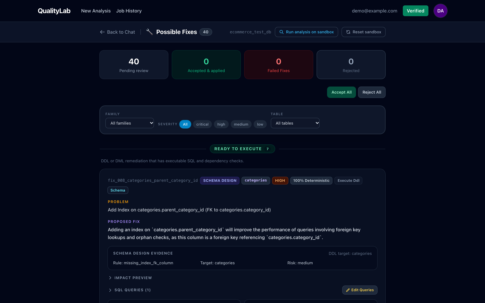
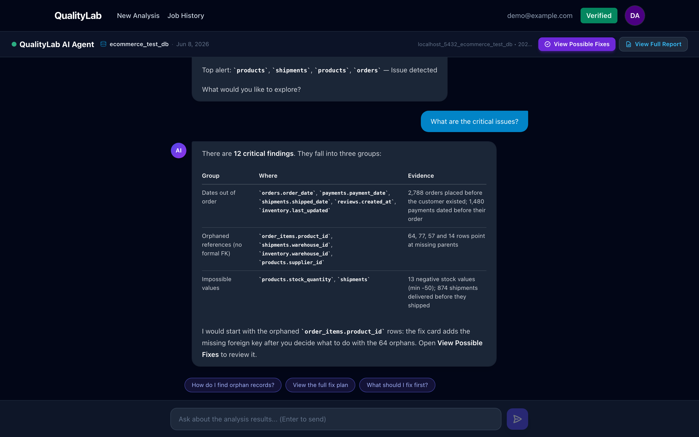
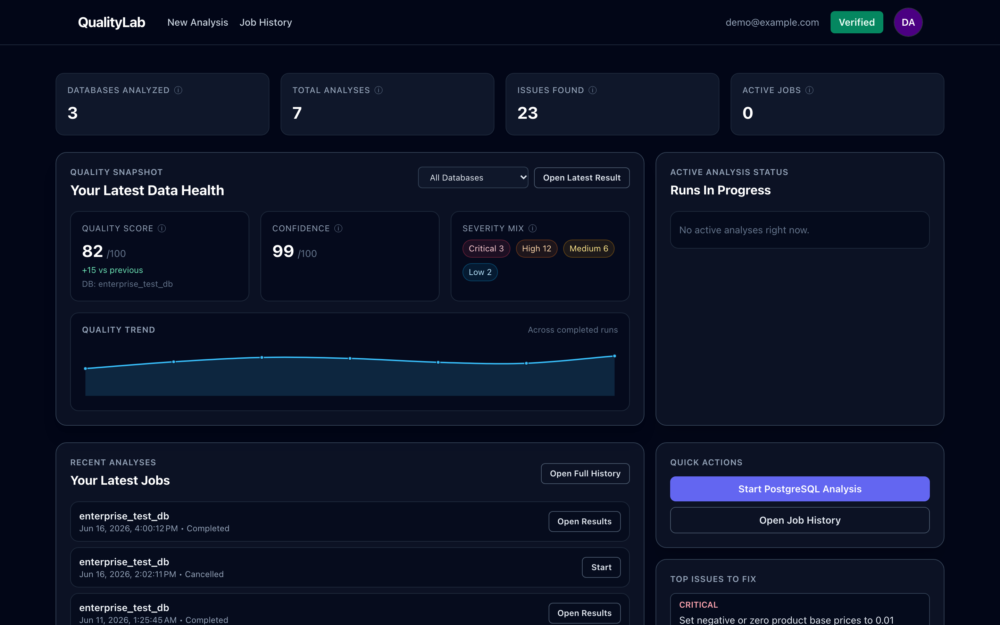
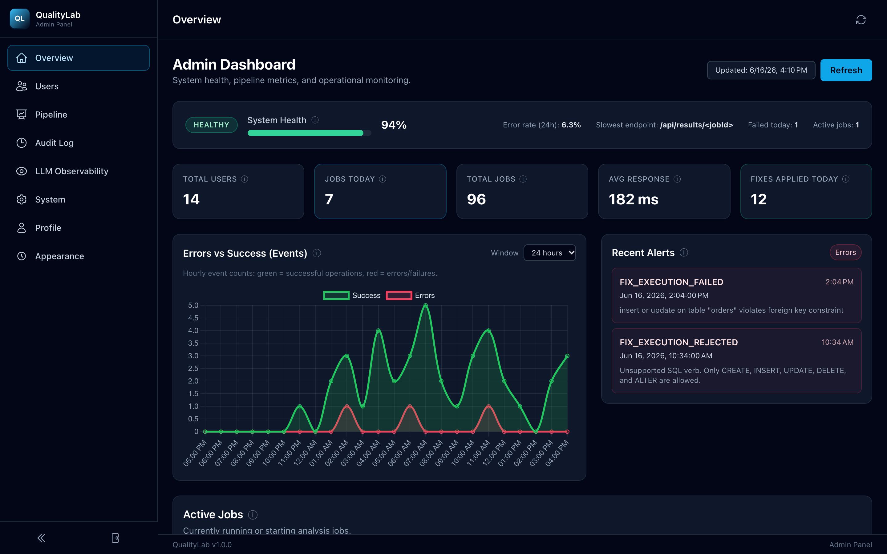
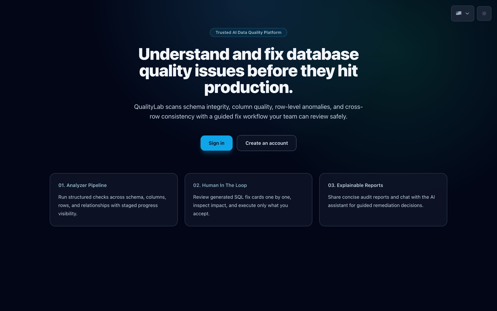

<div align="center">


# QualityLab: Backend

### AI agents that audit a PostgreSQL database and propose SQL fixes you approve

The Django API, Celery worker and multi-agent pipeline behind QualityLab.<br>
Point it at a database; it returns scored findings, explanations and fix cards that run only after a human accepts them.


-4285f4)


[Frontend repo (Angular)](https://github.com/Malekhalifa/PFE-Project-Frontend-Angular) &nbsp;·&nbsp; [How it works](#how-it-works) &nbsp;·&nbsp; [The agents](#the-agents) &nbsp;·&nbsp; [API](#api) &nbsp;·&nbsp; [Get started](#get-started) &nbsp;·&nbsp; [Reference](#reference)

</div>

---

## What is QualityLab?

**Why.** Bad data in a production database is quiet. Orders dated before the customer existed, foreign keys that point
at nothing, negative stock, columns that are 40% empty: none of these crash an application, and nobody looks until a
report is wrong. Writing checks by hand for every table is slow, and handing an AI model write access to the database
is not an option.

**What.** QualityLab connects to a PostgreSQL database, profiles every table, and runs a team of specialised AI agents
(schema, statistical, structural and relational validators) plus deterministic SQL checks. A planner then turns the
findings into **fix cards**: a problem statement, the evidence, the SQL, a risk level and dependencies. Nothing is
written until a person accepts a card, and accepted SQL runs in a **sandbox copy** of the database, inside one
transaction. An AI chat answers follow-up questions about the run.

**Result.** One run gives a Data Quality Score, a confidence score, an executive verdict, findings grouped by validator,
and a reviewable fix plan. The 88 run reports stored in [`reports/`](reports/) cover three test databases; a full run
averaged about 6.4 minutes, and the Data Fix Planner was the longest step (about 3 minutes on average).

QualityLab is two repositories. **This one is the backend.** The Angular single-page app lives in
[PFE-Project-Frontend-Angular](https://github.com/Malekhalifa/PFE-Project-Frontend-Angular).

<p align="center">
  
</p>

<sub>The pipeline screen while a run is in progress. Solid boxes are LLM agents, dashed boxes are pure-Python steps. The three validators run in parallel. Screens were rendered from the real Angular app with the API mocked from a stored run report (see [Screenshots](#screenshots)).</sub>

## How it works

<!-- diagram:system -->

<!-- /diagram -->

<sub>DRF = Django REST Framework; Celery = background task queue, with Redis as its broker; Agno = the multi-agent framework used for the agents and the workflow; AgentOS = Agno's server that hosts the chat team; sandbox = a copy of the target database created with `CREATE DATABASE ... WITH TEMPLATE`.</sub>

1. **Connect.** The user tests a DSN (`POST /api/test-postgres`), adds optional domain rules and picks a Gemini model.
   `POST /api/analyze-postgres` stores the job (the connection string is encrypted at rest) and queues a Celery task.
2. **Analyse.** The worker runs the Agno workflow below. Each step pushes a status (`running_schema`, `running_profiler`, ...)
   to the job row and over a Channels WebSocket; the frontend also polls `GET /api/status/<jobId>`.
3. **Reduce and plan.** A Python reducer deduplicates and ranks findings, then the Data Fix Planner writes fix cards and a
   Python verifier checks them against the live database.
4. **Report.** The result is saved in `AnalysisResult`, written to `reports/`, and the user gets an email when results are ready.
5. **Fix.** The user accepts cards one by one. `POST /api/execute-fix/<job_id>/` validates the SQL, then runs it in the
   job's sandbox database in one transaction. Every attempt lands in the audit log.
6. **Ask.** `POST /api/agent-chat` forwards questions, with the run's results as context, to the QualityLab team on AgentOS.

**Tech stack:** Python 3.14, Django 5 + Django REST Framework, Channels (WebSocket status), Celery + Redis, PostgreSQL
(psycopg2/psycopg 3), Agno 2.5+ with Google Gemini (`google-genai`), sqlglot for SQL safety parsing, PyYAML for domain
rules, dj-rest-auth + django-allauth + SimpleJWT for cookie auth and Google/GitHub login, Brevo SMTP via django-anymail for
email, `cryptography` (Fernet) for stored DSNs, and optional Langfuse tracing.

## The pipeline

<!-- diagram:pipeline -->

<!-- /diagram -->

<sub>Defined in `agents/validation.py` (`build_validation_workflow`). Deterministic Python detectors (`agents/py_profiler.py`) add findings next to the LLM ones; failed validators are retried, and quota or timeout errors from Gemini are classified and pushed to the UI.</sub>

- **Signals, not raw rows.** Validators compute metrics with SQL (null ratios, outlier counts, violation counts) and hand
  on compact findings with a SQL predicate, instead of passing sampled rows between agents.
- **Reducer.** Drops findings below a confidence floor (`QL_MIN_CONFIDENCE`, default 0.65), merges duplicates across
  validators, groups by table and rule, and keeps the top `QL_MAX_FINDINGS` (default 50).
- **Hallucination guard.** Findings that name tables or columns that do not exist in the schema are stripped and counted
  (`entity_hallucinations` in the result).
- **Fix planner guards.** Post-hooks check entity names, SQL safety (sqlglot) and run a pre-flight impact check on each card.
  The verifier then runs each card's verification queries, overrides cards that dismiss real profiler evidence, and adds
  missing `depends_on` links between DELETE cards on the same table.
- **Data Quality Score.** A weighted table-health ratio: each table is weighted by rows, columns and foreign-key fan-in;
  each finding adds a penalty by severity (critical 1.0, high 0.6, medium 0.25, low 0.05) times its confidence, with
  diminishing returns per table. 100 means no findings.
- **Learned rules.** Structural violations (custom rules, negative amounts, impossible dates, blank required fields) are
  stored per database as regression checks and pruned after 3 clean runs.
- **Domain rules.** `config/domain_rules.yaml` sets thresholds (null tolerance, violation percentage, naming convention)
  and is reloaded on every run; rules sent with a job are merged in.

## The agents

| # | Agent | Kind | Looks for |
|:-:|---|---|---|
| 1 | **Schema Integrity Validator** | LLM agent | Missing primary keys, nullable foreign-key columns, unindexed foreign keys, naming issues |
| 2 | **Database Profiler** | Python step in the pipeline (an LLM version exists for the chat team) | Row counts, null rates, cardinality, min/max, top values, outlier flags per column |
| 3 | **Statistical Validator** | LLM agent | Abnormal null rates, outliers, low cardinality, categorical drift, semantic mismatches |
| 4 | **Structural Validator** | LLM agent | Row-level violations: impossible dates, blank required fields, negative amounts, check-constraint breaches |
| 5 | **Relational Validator** | LLM agent | Orphaned references, duplicates on unique fields, functional-dependency and date-order violations across tables |
| 6 | **Data Fix Planner** | LLM agent | Turns findings into fix cards with SQL, risk level, rollback and verification queries, and dependencies |
| – | Reducer, fix verifier | Python | Dedupe and rank findings; check and repair the fix plan (zero LLM calls) |
| – | `QueryExecutorAgent` | Python | Runs one accepted card in the sandbox, in one transaction |

Each fix card has an **interaction model** that tells the UI how to treat it: `execute_ddl` (ready to run), `human_decision`
(you choose, for example, what to do with orphan rows), `investigate` (a `SELECT` that shows the affected rows), `advisory`
or `blocked`.

### Human-in-the-loop fix execution

<!-- diagram:fix -->

<!-- /diagram -->

<sub>The source database is never modified by a fix card. `POST /api/reset-sandbox/<job_id>/` rebuilds the sandbox from the source; `POST /api/analyze-sandbox/<job_id>/` re-runs the whole pipeline on the sandbox as a new job, so you can see whether the fixes raised the score. Creating the sandbox needs a role with `CREATEDB` on the target server (the app's own database user is used for that).</sub>

## API

All routes are under `/api` and require the auth cookie unless noted. Full contracts are in the docstrings in
[`api/views.py`](api/views.py).

| Method | Path | What it does |
|---|---|---|
| POST | `/api/test-postgres` | Test a DSN: `{connection_string}` → `{success, database, host, port}` |
| POST | `/api/analyze-postgres` | Start a run: `{connection_string, domain_rules, llm_model, baseline_job_id?}` → `{job_id}` |
| GET | `/api/status/<jobId>` | Current status and per-step start times |
| GET | `/api/results/<jobId>` | Full results payload (scores, verdict, per-validator reports, fixes, timing) |
| GET | `/api/results/<jobId>/diff` | Compare with the previous run (`?compare_to=` to pick one) |
| GET | `/api/results/<jobId>/export` | Download the report JSON |
| GET / DELETE | `/api/jobs` | List your jobs / bulk delete `{job_ids}` |
| DELETE | `/api/jobs/<job_id>/` | Cancel a running job (revokes the Celery task) |
| GET / POST | `/api/jobs/<job_id>/chat/` | Chat history for a job (`/api/chat-history/<jobId>` is an alias) |
| POST | `/api/agent-chat` | Ask the QualityLab team: `{message, session_id, job_id?, llm_model?}` |
| GET | `/api/fixes/<job_id>/` | Fix cards, database name and already executed fix ids |
| POST | `/api/execute-fix/<job_id>/` | Run one accepted card in the sandbox |
| POST | `/api/reset-sandbox/<job_id>/` | Recreate the sandbox from the source database |
| POST | `/api/analyze-sandbox/<job_id>/` | Analyse the sandbox as a new linked job |
| WS | `/ws/jobs/<job_id>/status/` | Status, stuck and error pushes (needs an ASGI server) |
| GET | `/health` | Database ping, no auth |

<details>
<summary><b>Auth endpoints</b></summary>

| Method | Path | What it does |
|---|---|---|
| POST | `/api/register` | Email + password sign-up |
| POST | `/api/login` | Sets the `token` (access) and `refresh_token` cookies |
| POST | `/api/logout` | Clears the cookies |
| POST | `/api/logout-all` | Revokes sessions on every device |
| POST | `/api/token/refresh` | New access cookie from the refresh cookie |
| GET / PATCH / DELETE | `/api/me` | Current user, update profile and preferences, delete account |
| POST | `/api/social-login` | Google ID-token exchange |
| GET | `/api/github/login`, `/api/github/callback` | GitHub OAuth redirect flow |
| POST | `/api/email-verification/resend` | Send a new code (cooldown applies) |
| POST | `/api/email-verification/verify-code` | Verify with the emailed code |
| POST | `/api/email-verification/verify-link` | Verify from the emailed link |
| POST | `/api/password/reset`, `/api/password/reset/confirm`, `/api/password/change` | dj-rest-auth password flows |

Analysis and fix endpoints refuse users whose email is not verified.

</details>

<details>
<summary><b>Admin endpoints (staff only)</b></summary>

| Method | Path | What it does |
|---|---|---|
| GET | `/api/admin/stats/` | KPI cards: users, jobs, active jobs, error rate, response time, fixes applied today |
| GET | `/api/admin/pipeline-performance/?days=7` | Average, min and max duration per pipeline step, from the stored reports |
| GET | `/api/admin/audit-log/` | Filtered, paginated audit events (`event`, `job_id`, `user_email`, dates) |
| GET | `/api/admin/error-timeline/?hours=24` | Hourly success and error counts |
| POST | `/api/admin/test-email/` | Send a diagnostic email to `ADMIN_EMAIL` |
| GET | `/api/admin/users/` | Paginated users with search and role/status filters |
| PATCH / DELETE | `/api/admin/users/<user_id>/` | Change role or active flag / delete |
| GET | `/api/admin/langfuse/status/`, `/api/admin/langfuse/traces/` | Langfuse proxy; keys never reach the browser |

</details>

<details>
<summary><b>Execute-fix response (execution log)</b></summary>

```json
{
  "status": "success | failure",
  "query": "<all queries joined as text>",
  "queries": ["<sql 1>", "<sql 2>"],
  "database_id": "<host_port_dbname>",
  "executed_at": "<ISO timestamp>",
  "duration_ms": 123,
  "rows_affected": 10,
  "transaction": "committed | rolled_back",
  "error": { "code": "<postgres code or null>", "message": "<db error>", "detail": "<detail or null>" },
  "query_logs": [
    { "index": 1, "query": "<sql>", "status": "success | failure", "duration_ms": 25, "rows_affected": 3, "error": null }
  ]
}
```

Audit events: `FIX_EXECUTED`, `FIX_EXECUTION_FAILED`, `FIX_EXECUTION_REJECTED` (SQL refused before execution).

</details>

## Screenshots

These are the Angular frontend's screens, rendered with Playwright. The API was mocked with data rebuilt from a real run
report in [`reports/`](reports/) (`ecommerce_test_db`, 8 June 2026); the user, the admin numbers and the chat reply are
demo data.

<table>
  <tr>
    <td width="50%"><br><sub><b>Results.</b> Verdict, scores and per-step timing for one run (361.5 s, Fix Planner the bottleneck).</sub></td>
    <td width="50%"><br><sub><b>Fix cards.</b> 40 cards to accept or reject; sandbox re-analysis and reset at the top.</sub></td>
  </tr>
  <tr>
    <td width="50%"><br><sub><b>AI chat.</b> Follow-up questions about the run, with suggested prompts.</sub></td>
    <td width="50%"><br><sub><b>Dashboard.</b> Latest score, severity mix, trend across runs and recent jobs.</sub></td>
  </tr>
  <tr>
    <td width="50%"><br><sub><b>Admin overview.</b> Health, KPIs, hourly errors vs successes, recent failed fixes.</sub></td>
    <td width="50%"><br><sub><b>Landing page.</b> Public entry point, in English, French or Arabic.</sub></td>
  </tr>
</table>

## Get started

You need Python 3.14, PostgreSQL (for the app's own data, and a target database to analyse), Redis and a Gemini API key.

```sh
python3 -m venv venv && source venv/bin/activate
pip install -r requirements.txt

# .env (gitignored) — see Reference for every variable
cat > .env <<'EOF'
SECRET_KEY=change-me
GEMINI_API_KEY=your-key
PG_DB=qualitylab
PG_USER=quality_user
PG_PASSWORD=strongpassword
REDIS_URL=redis://localhost:6379/0
JOB_CONNECTION_STRING_ENCRYPTION_KEY=any-long-random-string
EOF

python manage.py migrate
python manage.py runserver 0.0.0.0:8000                               # HTTP API
celery -A config worker -l info --concurrency=1 --prefetch-multiplier=1   # second terminal: pipeline runs
celery -A config beat -l info                                        # optional: stuck-job check every 5 minutes
python agents/agent_os.py                                            # optional: AgentOS on :7777 for the AI chat
```

`runserver` serves HTTP only; the frontend then falls back to polling. For WebSocket status pushes, serve
`config.asgi:application` with an ASGI server such as Daphne (`daphne -p 8000 config.asgi:application`).
Then start the [frontend](https://github.com/Malekhalifa/PFE-Project-Frontend-Angular), which expects the API on
`http://localhost:8000/api`. Use `localhost` everywhere: mixing it with `127.0.0.1` breaks the cookies.

```text
config/          settings, root URLs, Celery app (with the beat schedule), ASGI app, domain_rules.yaml
users/           custom User model, cookie-JWT auth backend, register/login/social login, email verification
api/             DRF views and URLs, models, serializers, WebSocket consumer, fix SQL safety, DSN encryption
agents/          Agno agents and workflow, Python profiler, reducer, fix verifier, query executor, Langfuse tracer, tests
services/        PostgreSQL connection helpers, report writer, email notifications
tasks/           Celery tasks: analyze_postgres_task, check_stuck_jobs
reports/         one JSON report per pipeline run (88 stored)
```

## Reference

<details>
<summary><b>Environment variables</b></summary>

Read from `.env` by django-environ (`config/settings.py`) or from the process environment.

| Variable | Default | Purpose |
|---|---|---|
| `SECRET_KEY` | built-in dev key | Django secret; must be set when `PRODUCTION=true` |
| `DEBUG` / `PRODUCTION` | `true` / `false` | Production also requires `GEMINI_API_KEY` and secure cookies |
| `ALLOWED_HOSTS` | `localhost,127.0.0.1` | Django allowed hosts |
| `PG_DB`, `PG_USER`, `PG_PASSWORD`, `PG_HOST`, `PG_PORT` | `qualitylab`, `quality_user`, `strongpassword`, `localhost`, `5432` | App database. This role also creates sandbox databases, so it needs `CREATEDB` on target servers |
| `REDIS_URL` | `redis://localhost:6379/0` | Celery broker and result backend, Channels layer |
| `GEMINI_API_KEY` | – | Required for every LLM call |
| `GEMINI_MODEL` | `gemini-2.5-flash` | Default model when a job does not pick one |
| `GEMINI_TIMEOUT`, `GEMINI_MAX_OUTPUT_TOKENS` | `300`, `65536` | Per-call timeout (s) and output cap |
| `JOB_CONNECTION_STRING_ENCRYPTION_KEY` | – | Key for encrypting stored DSNs (Fernet) |
| `QUALITYLAB_ALLOWED_DB_HOSTS` | unset (any host) | Comma-separated host patterns users may connect to |
| `DOMAIN_RULES_PATH` | `config/domain_rules.yaml` | Domain rules file |
| `QL_MIN_CONFIDENCE`, `QL_MAX_FINDINGS` | `0.65`, `50` | Reducer confidence floor and finding cap |
| `PROFILER_MAX_WORKERS`, `PROFILER_STATEMENT_TIMEOUT_MS` | `8`, `90000` | Python profiler concurrency and per-query timeout |
| `CELERY_WORKER_CONCURRENCY`, `CELERY_WORKER_PREFETCH_MULTIPLIER` | `1`, `1` | Kept low for LLM-bound tasks |
| `ANALYZE_POSTGRES_RATE_LIMIT`, `EXECUTE_FIX_RATE_LIMIT` | `10/hour`, `200/hour` | Per-user throttles |
| `USER_RATE_LIMIT`, `ANON_RATE_LIMIT` | `1200/hour`, `120/hour` | Global DRF throttles |
| `ACCESS_TOKEN_LIFETIME_MINUTES`, `REFRESH_TOKEN_LIFETIME_DAYS`, `ROTATE_REFRESH_TOKENS` | `60`, `7`, `true` | JWT lifetimes |
| `JWT_REFRESH_COOKIE_NAME` | `refresh_token` | Refresh cookie name (the access cookie is `token`) |
| `FRONTEND_URL`, `FRONTEND_VERIFY_EMAIL_URL` | `http://localhost:3000`, `<FRONTEND_URL>/#/verify-email` | Links in emails and OAuth redirects |
| `GOOGLE_OAUTH2_KEY`, `GOOGLE_OAUTH2_SECRET` | – | Google login |
| `GITHUB_KEY`, `GITHUB_SECRET`, `GITHUB_CALLBACK_URL` | –, –, `http://localhost:8000/api/github/callback` | GitHub login |
| `EMAIL_VERIFICATION_CODE_TTL_MINUTES`, `..._RESEND_COOLDOWN_SECONDS`, `..._MAX_ATTEMPTS` | `15`, `60`, `5` | Email verification |
| `BREVO_SMTP_HOST`, `BREVO_SMTP_PORT`, `BREVO_SMTP_LOGIN`, `BREVO_SMTP_KEY` | `smtp-relay.brevo.com`, `587`, –, – | Outgoing email |
| `EMAIL_FROM_NAME`, `EMAIL_FROM_ADDRESS`, `ADMIN_EMAIL` | `QualityLab`, `noreply@qualitylab.com`, – | Sender and admin test-mail recipient |
| `AGENT_OS_URL`, `AGENT_OS_TEAM_ID` | `http://localhost:7777`, `qualitylab-team` | Where the chat proxy sends questions |
| `LANGFUSE_PUBLIC_KEY`, `LANGFUSE_SECRET_KEY`, `LANGFUSE_HOST` | –, –, `https://cloud.langfuse.com` | Tracing; disabled when the keys are empty |

CORS and CSRF allow `http://localhost:3000` and `:4200` (and the `127.0.0.1` forms).

</details>

<details>
<summary><b>Data model</b></summary>

| Model | Holds |
|---|---|
| `users.User` | Custom user: role (`user`/`admin`), email verification, theme, language, accent colour, notification preferences |
| `Job` | One analysis run: UUID, owner, encrypted connection string, status, Celery task id, LLM model, link to the previous run |
| `AnalysisResult` | The full results JSON for a job |
| `ChatMessage` | Chat history per job (`user` or `agent`) |
| `AuditLog` | Fix executions, rejections and other sensitive events |
| `LearningPattern` | How often a user accepted or rejected a fix family on an entity |
| `LearnedRule` | Per-database regression rules, pruned after 3 clean runs |

Job statuses: `starting`, `running`, `running_schema`, `running_profiler`, `running_statistical`, `running_structural`,
`running_relational`, `running_reducer`, `running_fix_planner`, `running_fix_verifier`, then `completed`, `failed` or `cancelled`.

</details>

<details>
<summary><b>Celery tasks</b></summary>

- `tasks.postgres_tasks.analyze_postgres_task`: one full pipeline run (up to 2 retries, 30-minute hard limit). Sends
  "started", "results ready" or "failed" emails when the user has email notifications on.
- `tasks.postgres_tasks.check_stuck_jobs`: Celery beat, every 5 minutes. Finds jobs stuck in one step and pushes a
  warning or alert over the WebSocket.

</details>

<details>
<summary><b>LLM observability (Langfuse)</b></summary>

With the Langfuse keys set, every run is traced: a root span `qualitylab-pipeline` (`database_id`, `model_id`, `job_id`)
and one generation per LLM agent with token counts, tool calls and finding counts. The trace output carries
`data_quality_score`, `confidence_score`, `total_findings`, `total_fixes` and `total_duration_ms`. Tracing is fail-safe:
with empty keys the pipeline runs unchanged. Keys are read at import time, so restart Django after changing them.

For a local Langfuse, the parent project used a `langfuse-compose.yml` (not in this repository) on port 3001:

```sh
docker compose -f langfuse-compose.yml up -d     # first start takes a few minutes
docker compose -f langfuse-compose.yml down      # stop, keep data (add -v to wipe)
```

The admin panel's "LLM Observability" page reads traces through `/api/admin/langfuse/traces/`.

</details>

<details>
<summary><b>Tests</b></summary>

```sh
pip install pytest greenlet      # greenlet is needed by SQLAlchemy's async import in agno
python -m pytest agents/tests api/tests users/tests
```

Tests run on a throwaway SQLite database (`USE_SQLITE_TEST_DB` turns on automatically under pytest), with no Gemini
calls. On a fresh checkout with current package versions (November 2026): 192 passed, 16 failed, and
`api/tests/test_quality_gate_tools.py` does not import (it expects `enforce_quality_gate`, which `agents/tools.py` no
longer defines). The root-level `test_*.py` files are manual scripts, not pytest tests.

</details>

<details>
<summary><b>Notes</b></summary>

- Agent names in `agent_config.py` must match the `id=` values in `team.py`.
- Domain rules are injected by the `inject_domain_rules` pre-hook; never hard-code table or column names in agent config.
- The fix planner's schema snapshot leaves out foreign-key and index lists to save tokens; the planner calls
  `describe_constraints()` when it needs them.
- `python agents/agent_os.py` also serves the Agno playground for trying the team directly.

</details>

---

<sub>A final-year engineering project (PFE). Screenshots use demo accounts and data rebuilt from a stored test-database report; no real customer data is shown. README written with an AI coding assistant from the code in this repository.</sub>
